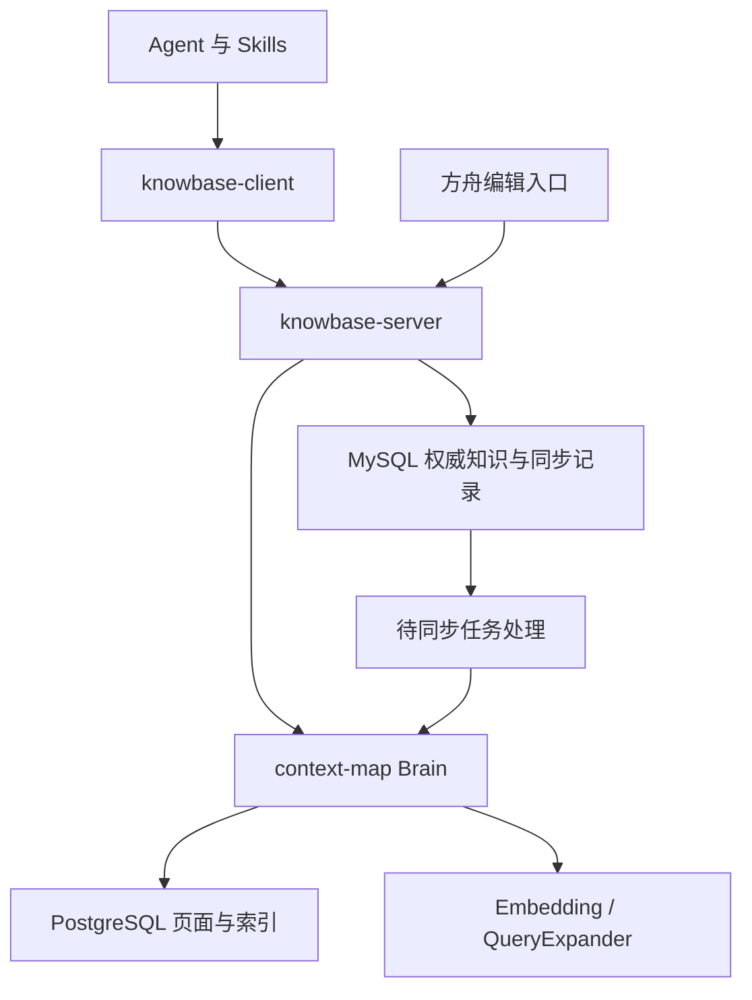
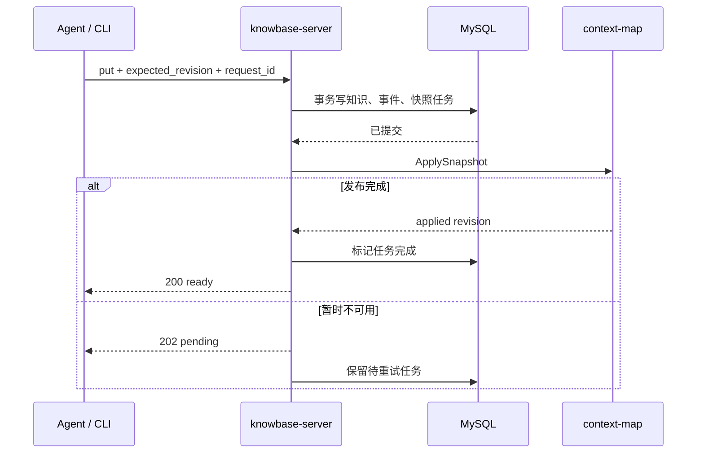

# Knowbase × context-map：完整项目技术实现与学习基线

版本：1.0｜整理日期：2026-09-22｜用途：项目接手学习、业务推演与后续代码补全。

## 0. 文档使用约定

**本文件是已采纳的学习实现基线。按照本轮明确要求，后续学习将本文描述的能力视为已经按此方案实现，不再把 context-map 源码缺失作为学习阻塞。**

证据边界：现有 Knowbase 代码与 PDF 能支持功能边界和多数调用契约；context-map 原工程未提供。本文补充的表、内部字段、同步机制、排序参数和模块路径，是为形成完整项目而固定的设计约定，不是原工程交付或上线事实。后文统一使用确定性表述，便于学习，不逐段重复“假设”。涉及实际源码核查、真实履历或上线状态时，仍区分“源码证实”与“学习基线”。

本文取代 `context_map_business_reconstruction.md` 作为**后续学习的主文档**；旧文档保留作缺失分析和依据说明。两者有设计差异时，以本文为学习约定，例如会议关系方向、MySQL 权威数据和同步补偿方式。

当前没有必须再向使用者确认的阻塞项。原材料未固定的部分已在本文给出单一选择；真实模型名称、生产地址、部署资源等不影响业务推演，保留为配置，不编造实际值。

## 1. 业务范围：这个模块解决什么问题

Knowbase 原有主线是“管理知识 → 配置与分发知识 → Agent 使用知识”；Brain 增加“从使用中沉淀知识 → 再次检索与应用”的循环。

| 业务 | 本基线中的职责 |
| --- | --- |
| 知识沉淀 | Agent 从对话/外部资料提炼事实，生成带来源的标准 Markdown，写入知识方舟 |
| 知识管理 | 方舟保存原文、版本、目录、成员权限和人工修改 |
| 知识加工 | context-map 解析页面、分块、建立词项与向量索引、维护关系和历史 |
| 知识查询 | 返回相关页面/片段、关联实体和历史事件 |
| 知识应用 | Agent 基于结果回答、分析故障或执行任务，并保留证据引用 |
| 持续维护 | 重试未同步记录，检查和修复可重建索引；外部资料仍通过 Agent 提炼后进入同一写入链路 |

基础写入不让 context-map 重新理解整段对话，也不让检索接口直接生成最终答案。embedding 是模型调用；query expansion 是可选的查询辅助；二者与对话知识提炼职责分开。

### 1.1 组件边界

| 组件 | 负责 | 持有的数据 |
| --- | --- | --- |
| Agent / Ducc / Skills | 触发回忆、提炼事实、读取后丰富、引用后回答 | 当前会话与工具结果 |
| knowbase-client | CLI 参数、认证凭据、调用 API、展示成功/待同步/失败状态 | 临时文件与可失效的 canonical-slug 缓存 |
| knowbase-server | 用户认证、知识本权限、权威写入、版本/幂等、同步编排 | MySQL 原文与版本、Brain 映射、事件、待同步记录 |
| context-map Brain | 页面投影、解析、检索、关系图、时间线和维护 | PostgreSQL 页面、chunk、向量、关系、事件等可重建数据 |
| 原知识加载链路 | 按配置取知识，完成缓存/分发以及运行环境中的使用准备 | 原有 Redis 缓存、文件/BOS 引用、沙箱中的知识材料 |

Redis 继续承担现有缓存职责；BOS 继续承担原项目文件存储职责。Brain 查询通过服务端 API 获取检索证据，无需把整个向量库装入沙箱。已有“知识应用配置 webhook”与本文件的“正文变更同步”是不同业务，不复用它的成功状态来证明 Brain 已更新。



## 2. 已固定的技术选择

下面是本基线的决定，不需要学习时重复选择方案。

| 问题 | 固定选择 | 必要性 |
| --- | --- | --- |
| 数据权威在哪里 | MySQL 的知识正文、版本、时间线事件和删除状态 | Brain 丢失后有可靠重建依据 |
| Brain 存储 | PostgreSQL + 向量检索能力；图关系也使用关系表 | 复用文档方向，无需另建图数据库 |
| 写入一致性 | MySQL 本地事务落权威数据与同步任务；提交后立即同步；临时失败留任务补偿 | 覆盖已经存在的两套存储，避免丢写 |
| 消息设施 | 一张 MySQL 待同步表，由普通任务函数扫描 | 不增加 Kafka、CDC 或分布式事务 |
| 索引发布 | 所需向量准备完成后，PG 一次事务发布该页面的完整新投影 | 防止半新半旧的正文、chunk 和关系 |
| 同步内容 | 带单调版本的完整页面快照，包含累计历史和删除标记 | 后到的完整新快照可以安全越过旧快照 |
| 范围 | 一次请求只访问一个真实知识本 UUID | 保持权限、分页、图谱与写入语义简单 |
| 人工优先 | 受保护页面禁止自动渠道覆盖/删除；人工管理渠道可修改 | 不引入字段级冲突合并或候选审核系统 |
| 检索 | 关键词召回 + 向量召回，按页面聚合后 RRF | 同时覆盖专有名词与同义表达 |
| 图谱 | 显式引用和结构化关系规则；有界 BFS | 不引入自由关系推理和全图推理 |
| 反向链接 | 查询已有边的入边 | 不自动改写目标页面制造反向正文 |
| 时间线 | 普通更新保留历史；独立追加去重且不重新 embedding | 保留过程并控制重复加工 |

暂不纳入核心：跨知识本聚合检索、自动实体合并/重命名、GraphRAG 自动扩展排名、独立图数据库、字段级人机合并、全量事件溯源架构、额外重排模型、v4 的 Entity/Perspective/Pulse、服务端对话 `/brain/ingest`。这些不是当前闭环的前置条件。

## 3. 身份、知识范围和稳定页面标识

### 3.1 统一 x-kb-uuid

现有 BrainHandler 把该值按用户名/数字群 ID 处理，而实际创建知识本时生成 UUID；因此直接把旧值既当群 ID 又当 MySQL knowledgebase UUID，会留下衔接缺口。

基线固定：`x-kb-uuid` 对下游永远代表**真实 Knowledgebase.UUID**；PG `source_id` 与之对应。client 配置优先级保持“显式 --kb-uuid → 环境配置”。

1. server 接受一个非空范围值，逗号多值返回 400。
2. 真 UUID 直接查询知识本；旧用户名/群标识只能通过明确配置的别名映射解析到唯一真实 UUID。没有映射返回明确错误，不静默建知识本或另建虚拟租户。
3. 解析后复用现有 Knowledgebase/PermissionService：读请求校验可读，写请求校验可写，删除校验对应删除权限。群依赖不可用返回 503，不能跳过成员检查。
4. admin 按现有管理权限处理，但仍检查目标知识本存在和可用。
5. server 使用平台凭据访问 context-map，只传规范化 UUID。context-map 验证平台调用身份，并对所有仓储查询强制带 source_id。

Brain 不信任客户端自称的身份、来源优先级或知识本归属。读权限在每次请求时重新依据现有权限体系判定，索引滞后不等于权限可以滞后。

### 3.2 页面身份与方舟目录

页面唯一键为 `(source_id, slug)`。slug 最长 255 字节，最多 5 段，每段为小写字母/数字及内部连字符；不接受空段、前后 `/`、`.`、`..`，URL 只解码一次。不自动把非法 slug 修成另一个页面。

首次创建仍映射到 `ark-brain/<slug目录>`，但建立 `slug ↔ knowledge_uuid` 的稳定绑定。后续更新按绑定定位，不能继续仅按目录加标题查找。标题是展示字段，人工改标题或在同一知识本移动目录不会创建第二个 Brain 实体。

绑定页面的跨知识本移动、slug 重命名和删除后复用旧 slug 不属于本基线的普通修改操作；明确拒绝，避免隐式搬迁破坏历史和关系。需要新实体时使用新 slug。版本回滚只处理仍存在的页面，并形成新的同步版本。

## 4. 数据模型：少量权威补充 + 可重建投影

下列是逻辑结构，不要求现在准备可执行 DDL。已有表复用；新结构名称属于本基线设计。

### 4.1 knowbase-server / MySQL

| 结构 | 关键内容 | 规则 |
| --- | --- | --- |
| 既有 knowledge / knowledge_version | 正文、展示标题、所属知识本/目录、版本快照、操作者 | 保留原有知识管理与版本业务 |
| `brain_page_binding` | source_id、slug、knowledge_uuid、source_revision、content_revision、content_hash、human_protected、deleted、last_confirmed_indexed_revision | `(source_id,slug)` 唯一；knowledge_uuid 绑定唯一；删除后保留身份和版本；下游确认版本单调更新 |
| `brain_timeline_event` | source_id、slug、event_id、date、summary、detail、source、recorded_at | `(source_id,slug,event_id)` 唯一；独立追加也先持久化到这里 |
| `brain_sync_task` | request_id、可信调用主体、请求指纹、source_id、slug、source_revision、snapshot、state、attempts、next_retry_at、last_error、原操作结果 | 与业务数据同事务；以 `(source_id,调用主体,request_id)` 去重；兼作幂等回执；保留完整快照 |

不把 `Knowledge.CurrentVersion` 的字符串标签直接用于排序。它承担方舟版本展示；Brain 另外使用单调递增整数 `source_revision`。

- `source_revision`：页面任何需要同步的状态变化都递增，包括独立历史追加、人工保护和删除。
- `content_revision`：标题/frontmatter/标签/当前正文等需重建内容投影的数据变化时递增；仅历史追加不变。
- `content_hash`：对标题/frontmatter 中参与检索与关系的字段、标签和当前正文计算 hash，不包含累计 timeline 与保护状态；支持判断内容投影是否变化。chunk 另有自身 hash 供向量复用；hash 不能替代版本并发控制。

知识版本记录的是保存过的 Markdown。仅把历史补入 Markdown 也可能产生新的方舟知识版本和 source_revision，但当前正文/关系输入不变时 content_revision 不递增；独立 timeline-add 不改原 Markdown，因此也不凭空新增正文版本。

**原文容量规则：**基础 Brain Markdown 上限为 65,535 UTF-8 字节，进入事务前检查。现有普通知识更新存在超出 TEXT 容量后清空 Content 的分支；绑定的 Brain 页面必须改为明确拒绝，不能清空后继续同步。时间线事件独立存表，同步快照字段需能容纳正文和累计事件，不沿用 knowledge.content 的 TEXT 容量作为快照限制。

### 4.2 context-map / PostgreSQL

| 结构 | 内容与约束 |
| --- | --- |
| sources | source_id 与知识本映射，不复制一套用户权限系统 |
| pages | slug、原始 Markdown、compiled_truth、frontmatter、类型/标题/标签、source_revision、content_revision、删除标记 |
| content_chunks | 页面、内容版本、位置/标题路径、text、hash、词项、embedding、embedding_model |
| links | from_slug、to_slug、link_type、origin_slug、link_source、context；一条记录表示一个来源对关系的声明 |
| timeline_entries | MySQL 累计事件的查询投影，event_id 唯一 |

links 的唯一约束覆盖 `(source_id,from_slug,to_slug,link_type,origin_slug,link_source)`。相同关系被多个来源声明时分别保留；查询按逻辑边去重，不需要再建单独图服务或完整溯源平台。

页面标签存 pages 的结构化字段即可；是否为检索性能增加独立 tags 表属于存储优化，不影响业务模型。原始外部资料可继续引用既有知识/BOS/source URL；不强制另建一个原始资料系统。

## 5. 标准知识文档与解析规则

一个可推演的输入如下。演示事实为虚构数据。

````markdown
---
type: incident
title: Atlas Redis 连接池耗尽
tags: [redis, connection-pool]
---

# 当前结论
[[projects/atlas]] 曾发生连接池耗尽。[[people/chen]] 将连接池上限调整到 100 后恢复。
[来源：icafe/ATLAS-123]

## 时间线
- 2026-09-18 | 调整连接池上限后恢复 | source: icafe/ATLAS-123
````

固定解析顺序：

1. 只把文件开头完整的 YAML 块视为 frontmatter；代码块、后续 `---` 均不误识别。
2. title 优先来自 frontmatter，无则取首个一级标题，再无则用 slug 末段；type 无则设 `note`；tags 去重并规范化。
3. compiled_truth 为移除 frontmatter 和约定时间线节后的当前正文，保留来源引用；不进行额外生成式改写。
4. 当前正文及结构化关系字段中的 `[[slug]]` 与合法内部 Markdown 链接解析为内部引用；时间线节的引用仅保留为事件证据。外部 URL 保留为来源，不自动造实体。
5. 时间线只读取约定节内的显式日期记录。无有效日期的事实留在正文，不拿写入时间冒充发生日期。
6. server 与 context-map 使用同版本的文档规则/纯解析组件。server 提交前完成确定性校验与事件提取；context-map 使用相同规则构建查询投影。

Brain 页的 title/type/tags 以标准知识文档为准。方舟对绑定页面编辑标题/标签时，统一入口同步更新文档对应字段再保存；不维护两套互相竞争的元数据。其他普通知识的标签业务保持原有规则。

## 6. 写入主链路：Agent 沉淀后如何变成可查询知识

### 6.1 Agent / CLI

1. 用户问题进入宿主，brain-ops/query 按任务先检索已有知识。
2. 响应后的 notify/sidecar 从新会话片段中提炼值得保存的事实；Ducc 执行提炼和工具调用。
3. Agent 先 search 判断已有实体，再 get 读取当前页面，结合新事实生成完整 Markdown。
4. CLI 发 `PUT /open-api/v1/brain/page`，包括 `slug/content/expected_revision`；每次逻辑操作在第一次调用前固定 request_id，网络重试及重新执行命令均沿用同一值。
5. 新建使用 expected_revision=0；更新使用 get 返回的 source_revision。遇 409，Agent 重新读取和合并，不自动覆盖。

为避免索引滞后导致反复 409，**公开精确 get 由 server 读取 MySQL 同一权威快照中的正文、元数据和 source_revision**，并按统一文档规则生成 compiled_truth；附 indexed_revision/sync_status。检索、图谱与时间线仍读取 PG 已发布投影。fuzzy 先取得候选，唯一候选再读取权威页面。不能给 PG 旧正文拼接 MySQL 新版本号。indexed_revision 表示 server 已确认的下游版本；确认响应丢失时保守显示 pending，重试确认后更新。

### 6.2 server 权威事务

共用一个 BrainMutationService，供 BrainHandler、方舟绑定知识编辑和维护导入调用：

1. 认证、解析真实知识本 UUID、校验本次操作权限；检查正文大小和文档格式。
2. 按 `(source_id,slug)` 锁定 binding；新建依靠唯一约束处理并发创建。
3. 先检查同 request_id 的回执。请求指纹相同返回原业务结果与当前同步状态；不同返回 409，不能让同一个键代表两次不同写入。
4. 检查 expected_revision；检查自动渠道是否被 human_protected 禁止。
5. 合并文档中提取的 timeline 事件。规范化 Markdown 与现有保存内容相同且无新增事件/保护变化时，不增加知识版本和 source_revision；仍在任务表保存仅用于幂等的请求指纹和 skipped 回执，不创建新的投递。同步状态取该页面真实状态，不能因这条回执已保存就把原 pending 变成 ready。
6. 更新 knowledge/版本/操作日志、binding、累计 timeline；产生完整快照任务，同一个 MySQL 事务提交。MySQL 失败立即返回失败，不继续向 Brain 写入孤立数据。
7. 事务提交后立即执行一次同步尝试。HTTP 调用和 embedding 不放进 MySQL 长事务。

完整快照包含：`source_id/slug/knowledge_uuid/source_revision/content_revision/content/human_protected/deleted/timeline[]/request_id`。累计 timeline 包括正文提取及独立 timeline-add 事件。它是当前完整状态，不是“本次多了两条事件”的增量片段。

### 6.3 context-map 一次完整发布

统一内部函数 `ApplySnapshot`：

1. 验证平台凭据、范围、字段与版本；读取当前投影。
2. 如果输入版本小于当前版本，返回已被新版本覆盖；相同版本同快照返回幂等结果；同版本不同业务内容返回冲突并记录错误。快照业务 hash 排除 request_id、投递状态等传输字段，防止重建同版本时误判冲突。
3. 对新内容解析、分块、计算链接差异；只为变化的 chunk 生成向量。同 content_revision 的纯 timeline 更新复用原正文、chunk 和关系。
4. 向量准备完成后开启 PG 事务，再次锁页面并比较 source_revision，防止较旧的慢任务覆盖较新的快照。
5. 同事务更新页面、当前 chunk、关系声明、标签和 timeline 投影；删除快照则发布墓碑并移除普通查询可见性。
6. 提交后返回 applied revision、实际统计。准备/事务失败保留旧投影；不会暴露半套新数据。



### 6.4 完成语义与最小补偿

| 结果 | 对调用方的意义 | 后续动作 |
| --- | --- | --- |
| 200 + sync_status=ready | 权威数据已保存，该版本或更新版本已发布 | CLI 可确认完成；处理 canonical 缓存和临时文件 |
| 202 + sync_status=pending + persisted=true | 权威数据已保存，检索索引暂未追上 | CLI 明示待同步，保留 --file；不宣称可立即查到 |
| 提交前 4xx/5xx | 本次业务变更没有提交 | 修正请求或重试 |
| 提交后永久拒绝 | 返回实际错误，并附 persisted=true、sync_status=failed | 保留权威数据和失败任务，修正后重放；不能伪称回滚 |

202 是本基线增加的必要契约。现有 CLI 只接受 200，需要同步修改。它不是增加第二套异步 embedding 流程，而是对跨服务部分成功的真实表达。

`RunPendingOnce` 读取到期任务，重用同一快照/request_id；暂时失败退避，永久格式/权限错误标 failed。多个任务针对同一页面可重复投递，PG 版本判断保证不倒退。首次实现无需 MQ；任务需有原子领取或短租约，进程退出后可以重新领取。

索引已应用但响应丢失时，重试返回幂等结果。标记任务完成失败时，也可安全重试。任务状态可作为写接口重试响应返回，无需先增加任务中心页面。

200 保证的是确认时该版本已发布，不保证后续无人更新。202 期间精确 get 读取 MySQL 最新正文并标出 pending，检索/图谱/时间线读取最近已发布投影；删除请求若为 202，精确 get 已按权威删除返回 404，但检索等投影尚可能有旧数据，只有 ready 才承诺各普通查询均不可见。权限校验始终依赖 server 当前权限，不依赖 Brain 中的旧状态。

## 7. 方舟编辑、人工优先、回滚和删除如何接通

### 7.1 人工编辑与自动沉淀

所有绑定 Brain 的知识编辑复用第 6 节权威事务和快照同步；普通未绑定知识不自动全量进入 Brain。

来源优先级按**受控业务渠道**判定：自动沉淀入口为 auto；有修改权限的方舟管理入口为 manual。它是渠道策略，不是从同一个用户名或 token 中识别“真实人类”。能合法调用管理入口的 Agent 也按该渠道规则处理，不能宣称存在仓库未证明的人类身份认证。

manual 修改将 human_protected=true；auto 的正文覆盖、删除和重新创建受保护/已删除页面均拒绝。自动追加历史允许，但必须保留来源，不修改人工确认的当前结论。无须引入字段级合并或候选审核区。

普通版本回滚视为 manual：读取旧知识内容，保存为新的当前状态、新的 source_revision 并重新投影，不把 source_revision 回退到旧值。历史事件默认保留；回滚正文不抹去曾发生的历史。

### 7.2 稳定绑定覆盖所有修改入口

必须接入的入口包括：Brain put、绑定知识 UpdateKnowledge/DeleteKnowledge、版本回滚、目录批量删除和知识本删除。只补一个 BrainHandler 无法覆盖方舟页面中的操作。

同知识本目录移动只改变管理位置，不改变 slug。标题修改按绑定更新原页面。目录批量删除要为受影响的绑定页生成删除快照，不能只调用批量软删后结束。知识本删除/停用立即阻止新读取和写入，再处理所属页面清理任务。

### 7.3 删除

在 MySQL 一次事务内软删知识、保留 binding 墓碑、递增 source_revision、写删除快照和操作日志。PG 应用快照后：

- get 返回 404；search/query/list 不再返回该页面。
- graph/backlinks 不返回关联到已删除节点的可见边。
- timeline 普通接口不再暴露该页事件。
- 删除页面自己拥有的关系声明失效；别的页面中的原始引用可以作为不可解析引用保留，不制造活节点。
- 重复删除幂等；乱序旧 put 快照不能覆盖较新的墓碑。

MySQL 时间线按项目留存规则保留，供重建判断；仍可能收到旧快照时，binding 墓碑及 PG 删除版本下界不得物理清除。清理正文或索引不等于清理身份与版本防线，否则延迟旧 put 会被误当首次创建。这里不新增恢复工作流。

## 8. 时间线：独立追加和重建都不能丢历史

`POST /timeline/*slug` 验证有效日期、非空 summary、访问范围和页面未删除，然后锁最新 binding 并追加事件。

- 不要求调用者拿旧 content_revision 来做更新前置条件；它是在最新状态上追加事实。
- 优先采用稳定 event_id；旧调用方没传时，由规范化的 `date+summary+detail+source` 计算事件身份。正文解析与独立追加采用同一规范，相同内容才合并；无法确认同一事件时不强行语义合并。
- 同日不同事件保留；同一事件重试不新增。
- MySQL 累计事件与 source_revision 同事务更新；content_revision 不变。
- 推送完整当前快照；若 PG 的 content_revision 已等于快照值，仅更新事件及 source_revision，不重分块、embedding 或重建链接。若 PG 尚缺该正文版本，仍先补齐对应内容投影，再发布累计事件；不能因请求起因是 timeline-add 就跳过缺失正文。
- 查询按 date 倒序，event_id 作为同日稳定次序；since/until 为包含端点的日期区间，since > until 返回 400。

get.content 表示最近保存的知识 Markdown；timeline 接口表示完整累计历史，可能含独立追加而尚未出现在正文中的事件。Skill 获取历史时显式调用 timeline，不假定 get.content 是事件总账。

**为什么完整快照能应对乱序：**正文版本 7 之后追加事件形成 source_revision=8，再改正文形成 9；快照 9 包含截至 9 的累计事件。即使先应用 9 再收到 8，跳过 8 也不会丢历史。若快照只带各自增量，这个推理就不成立。

## 9. 检索实现：search、query 与模型依赖

### 9.1 分块

按标题层级与段落切分，保留标题路径和原文位置；尽量不拆代码块和引用。基础目标块长 800 个 Unicode 字符、硬上限 1,200，超长段落再切分，相邻长段切片最多重叠 100 字符。参数是学习基线选择，实际模型上下文上限仍需校验。

chunk 记录 hash、embedding_model、维度和内容版本。同模型同内容可复用向量；模型变更时重建，不能混合比较。1536 维只是原文档示例，不作为已知生产配置。

### 9.2 关键词 search

范围过滤 → 查询规范化/分词 → 标题、slug、正文词项匹配 → 页面聚合 → 排序 → offset/limit。

中文与中英文混合文本采用同一服务内的词项化规则：英文和数字连续串规范化，中文连续片段采用二元词项，并在索引中保留单字词项以支持单字查询；建索引与查词使用相同规则。PG 对预处理词项建立全文索引。该方案提供确定的中文匹配能力，复杂分词优化后置。

精确 slug/标题优先，其次标题词项，再正文相关性；同分按 slug 稳定排序。关键词 search 用于快速定位与实体查重，不调用 embedding。

### 9.3 自然语言 query

1. 原始问题保留；expand=true 时最多生成 3 个补充表述。扩展失败继续原问题，不写知识库。
2. 在本 source_id、未删除页面、当前有效 chunk 内进行向量召回和关键词召回。
3. 每路最多取 `min(5×limit,500)` 个候选 chunk；各路先按页面聚合，保留最相关证据。
4. 两路按页面名次 RRF 融合，固定 `score=1/(60+rank_vector)+1/(60+rank_keyword)`；未命中一路，该路贡献为 0。rank 从 1 开始。
5. 扩展查询在每路内部合并去重，取各页面最佳名次，不因生成多个近义问题而重复加分。
6. 返回 TopK 页面及有限片段，附 source_id/slug/位置/来源；Agent 必要时 get 精读。

图查询保持独立。关系型问题由 Skill 调 graph-query，不自动把邻居塞进 query 排名，不新增重排模型。

detail 固定：low 返回最多 600 字符的当前正文摘录；medium 每页最多 3 个片段；high 每页最多 8 个片段。每片段最多 1,000 字符，单次所有证据文本预算 12,000 字符，超出时优先保留高排名证据并标记 truncated。这些裁剪是摘录，不调用模型总结。

### 9.4 降级

| 故障 | 行为 |
| --- | --- |
| QueryExpander 不可用 | 仅使用原问题 |
| 查询 embedding 不可用 | 关键词检索降级，响应 header 标明 keyword_only，CLI 明示 |
| 两路召回均失败 | 返回 503，不把错误当成空结果 |
| 写入 embedding 失败 | MySQL 数据已保存、同步 pending；PG 保持旧完整版本 |
| 结果为空 | 返回 []，Agent 说明没有相关知识 |

`X-Brain-Retrieval-Mode: hybrid|keyword_only` 由 server 透传，保留读取结果的裸数组结构。模型适配器未接入的纸面实现，只能称排序逻辑具备；本学习基线假定可用的 Embedder 已接入，但不声称已验证某厂商模型、实际召回率或延迟指标。

## 10. 图谱与反向链接

关系来自结构化 frontmatter 和内部引用，不从任意一句话中自由推断。固定方向：

| 关系 | 方向 |
| --- | --- |
| works_at | 人物 → 公司 |
| founded / advises | 人物 → 公司 |
| invested_in | 投资主体 → 被投对象 |
| attended | 会议 → 参与人物，与当前 Skill 示例保持一致 |
| mentions | 当前页面 → 被引用页面 |
| source | 当前页面 → 明确引用的内部来源页；外部 URL 保留为证据字段 |

frontmatter 中 works_at/founded/advises/invested_in/source 可给一个 slug 或 slug 列表；会议 attendees 列表生成 attended。普通内部引用默认 mentions，不推断雇佣关系。typed relation 与普通 mentions 是不同类型声明，查询按类型区分。

写入按 origin_slug 比较新旧声明，仅撤销当前页面拥有的过期声明。图查询把多个有效声明折叠成同一逻辑边；另一个来源仍支持该关系时，边仍存在。

backlinks 为入边查询，无需自动修改目标页面。被引用页面尚不存在时保留引用声明，图查询只返回两端均有效的边；目标出现后可自然变为可见，不需要创建虚构页面。

graph 使用有界 BFS：direction=in/out/both；按 type 过滤；节点记录最小距离、边独立去重；即使目标节点已访问也能记录符合条件的循环边，但不重复展开该节点。返回真实 from/to，不翻转事实方向。深度为该边被发现时距起点的最小跳数。

默认 depth=2、上限 3，最多 200 节点/500 边；达到上限给截断提示。方向、边类型过滤在每次扩展时执行，source_id 在每一步都必须一致。

## 11. 10 个外部接口与最小协议增量

公开路径前缀保持 `/open-api/v1/brain`。Brain 延续客户端现有 snake_case；不把整个 Knowbase 的 camelCase 接口一起重构。

记号：P=`source_id,slug,type,title`；R=`P,score,compiled_truth`；E=`from_slug,to_slug,link_type`。

| HTTP / 路径 | 输入 | 输出核心字段 |
| --- | --- | --- |
| PUT /page | slug,content,expected_revision；X-Request-ID | slug,status,source_revision,indexed_revision,sync_status,chunks,links,timeline |
| GET /page/*slug | fuzzy 默认 false | P,content,compiled_truth,frontmatter,tags,source_revision,indexed_revision,sync_status,created_at,updated_at |
| GET /search | q,limit,offset | R[]，带证据来源 |
| GET /query | q,limit,expand,detail | R[]，按 detail 含 chunks、source、truncated |
| GET /page | type,tag,limit,offset | (P,updated_at)[] |
| GET /backlinks/*slug | slug | (E,link_source)[] |
| GET /graph/*slug | type,direction,depth | (E,depth)[] |
| GET /timeline/*slug | since,until,limit | (slug,event_id,date,summary,detail,source)[] |
| POST /timeline/*slug | date,summary,detail?,source?,event_id?；X-Request-ID | status,source_revision,indexed_revision,sync_status |
| DELETE /page/*slug | query 参数 expected_revision；X-Request-ID | slug,status,source_revision,indexed_revision,sync_status |

返回统计：chunks 是当前有效块数；links={created,removed,errors} 为本次关系声明变化；timeline={created} 为本次新增事件数。普通 ignored/unresolved 引用作为明确解析告警，内部处理失败不能仅累加 errors 后伪装完整成功。

202 的三类写响应都包含 persisted=true；尚无可靠加工统计时省略 chunks/links/timeline，不能填 0 冒充已经处理。query 的 chunks 项固定为 `{text,position:{heading_path,start,end},source}`，位置按 Unicode 字符偏移表达；页面项的 truncated 表示该页证据被裁剪。单次总预算或图遍历达到上限时使用 `X-Brain-Truncated: true`，server 透传、CLI 展示，避免给裸数组临时增加 data 包裹。

列表成功直接返回数组，空结果为 []。普通成功 200，持久化后暂未同步 202。错误为 `{code,message}`，需要说明部分提交时附 `persisted/sync_status/source_revision`。语法 400、未认证 401、无权 403、不存在 404、版本/歧义 409、缺少写前置版本 428、服务暂不可用 503；下游永久拒绝不能包装成 200。

limit 默认 20、范围 1–100；offset 默认 0 且非负；query 默认 expand=true、detail=medium；graph 默认 both/2。非法值返回 400，不继续采用 Atoi 失败后的 0。query 暂无 offset，保持现有调用方式。list 按 slug 稳定翻页；分页期间不承诺跨请求快照隔离。

fuzzy 先精确 slug，再本范围标题/别名匹配；唯一候选返回页面，多个候选返回 409 与 candidates，零候选 404。

向 context-map 的写请求增加内部 `snapshot` 信封：PUT/POST timeline/DELETE 最终都调用 ApplySnapshot。只信任 server 生成的 source_revision、累计历史和渠道判定，不能把客户端正文中的这些字段直接透传为可信状态。10 类公开入口保持不变；精确 get 在 server 组装权威页面，其余检索型读取使用 context-map，后者的 page 读取仍可用于内部投影检查。

`default-model` 仍属于 Knowbase 原有配置业务。外部原文导入复用同一 server 内部写服务，无需为核心闭环再开一个公开 `/brain/import` API。

## 12. CLI、Skill、Agent 必须同步采用的行为

| 位置 | 固定修改 |
| --- | --- |
| internal/brain/types.go | auto_links 对齐为 links；补 timeline/source_id/source_revision/chunks/detail/sync_status；需要时兼容读取旧 auto_links |
| internal/brain/client.go | 识别 202 与错误附加状态；稳定 request_id；透传 retrieval mode；不把非空错误 JSON 当成功结果 |
| cmd/brain/put.go | 新增前置版本支持；ready 后才确认索引完成、更新 canonical 缓存和删除 --file；pending 保留文件并明确提示 |
| get / delete / timeline-add | get 展示 source_revision；delete 传前置版本；追加历史带事件身份；输出保留来源和 detail |
| query / search / graph 输出 | 保留本文声明的证据字段与截断/降级提示；机器使用 --json，禁止展示层静默截断关键证据 |
| brain-ops Skill | 读现有版本再覆盖；引用自动解析；反向关系调用 backlinks；不强制二次改写目标页 |
| query Skill | 区分关键词、混合、关系和时间线；返回按页聚合且携带片段；统一参数默认值和 attended 方向 |
| notify / sidecar | 整个片段计划产生的全部操作均持久化，或明确判定无需写入，才推进游标；ready 才宣称已可检索；不能仅靠子进程退出 0 判定沉淀成功 |

CLI 固定新增 `--expected-revision` 与 `--request-id`：put 把版本放 JSON；delete 把版本放 query；所有修改通过 X-Request-ID 传逻辑请求身份。自动流程在现有会话状态目录保存“会话窗口、操作清单、request_id、请求指纹、持久化回执”，第一次发送前落盘，重跑复用；人工命令生成的 request_id 同样保存在本地请求记录并可显式复用。409 后重新合并形成不同正文，属于新逻辑请求，使用新 ID。

pending 已有 MySQL 权威数据和持久同步任务，因此**整个片段所有应写操作**取得 200/202 持久化回执后，sidecar 可以推进游标；一页成功而另一页未提交时不推进。无需写入的片段要有明确完成结果。当前 notify 中提前更新游标的顺序需移到上述确认之后，Skill 措辞本身不能修正它。操作清单用于逐项检查，不引入通用工作流引擎。

CLI 保留临时文件不代表消息未接收。无法确定提交结果的网络故障沿用 request_id 重试原操作；已部分完成的窗口重跑时，已持久化操作通过回执去重，不再次生成知识版本。下游永久失败且 persisted=true 的回执需保留错误状态，交由同步修复处理，不能默认为已可检索。

只有独立发生、未在当前文档写入过的事件才额外 timeline-add。即使误发重复内容，服务端仍通过 event_id 去重。

来源输出固定包含 source_id 与 slug；来源 URL/会话引用单独保留，不能把 scope 标识当成具体事实证据。Agent 回答时引用实际命中的页面和原始来源，对空白和冲突明确说明。

## 13. 维护任务与外部资料：复用核心链路

Dream 的最小实现为 `RunMaintenanceOnce(source_id,cursor)`：

1. 重试到期同步任务、报告永久失败；以任务记录为准，不用一个全局游标覆盖失败项。
2. 扫描 Brain 绑定知识，比较 MySQL source_revision 与已发布版本，补漏快照。
3. 检查 Markdown、不可解析引用和孤立页面；报告问题，不擅自重写人工正文。
4. 根据当前权威快照修复关系和时间线投影；维护专用 repair 路径允许相同 source_revision 重新构建派生数据，否则正常幂等跳过无法修复损坏。发布时仍复核 source_revision/content_revision，变化则丢弃旧修复结果；反向链接依靠查询，不维护第二份反向事实。
5. 对过期模型向量重新生成，发布前再次确认内容版本未变；不让维护中的旧计算覆盖新写入。

外部 Wiki/iCafe 等资料沿原有加载/Agent 体系进入：读取外部资料 → KnowledgeExtractor/沙箱 Agent 提炼标准 MD → 调用 server 自动渠道 → 权威事务 → 同步 Brain。沙箱负责提炼和工具执行，不能绕过 server 直接改 PG。外部资料更新按来源版本判断，未变不重复提炼。

核心无需新增定时服务；逻辑用一次执行函数表达，部署时复用现有调度入口。调度、外部模型实际运行性能不在本文件验证范围。

### 重建

从 MySQL 枚举 binding 的最新状态、正文和累计事件，逐页应用最新完整快照；三者必须在同一一致性读中读取，或直接复用对应版本的持久快照，不能把旧正文冠以新版本号。包含删除墓碑，不把目录里仍可查到的旧版本重新当成活页面。重建期间仍按 source_revision 处理新变更，旧快照不能倒灌。

若 PG 完全重置，先恢复范围/页面再建立可见关系，未存在的端点暂不可见；最后完成索引刷新。不能仅扫描原始 Markdown 重建全部历史，因为独立 timeline-add 不一定写回正文。

## 14. 实际补代码的依赖顺序与模块落点

路径为建议新增/调整位置；不表示缺失原工程本来使用这些文件名。

| 顺序 | 代码落点 | 必须实现的逻辑 | 完成后的业务结果 |
| --- | --- | --- | --- |
| 1 | server 的 scope resolver；Brain DTO；Skill 文档 | 真实知识本映射、单范围权限、slug、版本与 JSON 契约 | 各层对同一页面身份和成功状态含义一致 |
| 2 | server `brain_mutation_service.go`；binding/timeline/task 仓储 | 权威事务、请求幂等、版本、完整快照、人工保护 | put/edit/delete/timeline 有一致的权威入口 |
| 3 | context-map `model.go/document.go/chunker.go` | 解析、字段规则、分块、稳定事件与引用 | MD 能确定地产生结构数据 |
| 4 | context-map `writer.go/repository.go` | ApplySnapshot、版本判定、向量准备、PG 原子发布 | 一次写入生成完整可读投影 |
| 5 | context-map `search.go/query.go` | 词项召回、向量相似度、页面聚合、RRF、预算、降级 | 能按名称和自然语言找知识 |
| 6 | context-map `graph.go/timeline.go/reader.go` | 有向遍历、反向链接、历史筛选、模糊候选、删除可见性 | 关系和历史查询完整 |
| 7 | server 既有 knowledge/directory/version 服务；sync worker | 人工编辑/回滚/批量删接入、同步重试、错误状态传播 | 方舟操作与 Brain 投影闭环 |
| 8 | client Brain 命令与 Skill 资源 | revision/request_id、202、证据字段、canonical 缓存、游标语义 | Agent 实际按一致契约完成沉淀与应用 |
| 9 | maintenance/external extraction 适配 | 单轮修复、重建、外部标准 MD 导入 | 知识长期变化后仍可持续维护 |

业务接口示意：

```text
BrainMutationService.Put(scope, actor, requestID, slug, expectedRevision, markdown)
BrainMutationService.AppendTimeline(scope, actor, requestID, slug, event)
BrainMutationService.Delete(scope, actor, requestID, slug, expectedRevision)
ContextMap.ApplySnapshot(scope, completeSnapshot)
ContextMap.Search(scope, query, limit, offset)
ContextMap.Query(scope, query, expand, detail, limit)
ContextMap.Graph(scope, slug, type, direction, depth)
SyncWorker.RunPendingOnce()
Maintenance.RunOnce(scope, cursor)
```

不要求运行时，可以用内存仓储表达事务和数据变化，但解析、去重、差异、版本判断、排名融合和图遍历必须有真实算法；真实 DB/HTTP/模型连接留在适配层。全文示意没有代替真实源码编译、运行或线上联调验证。

## 15. 一条完整业务推演

假设知识本 K 中已有项目 `projects/atlas` 与人物 `people/chen`。

1. Agent 分析故障，提炼 `incidents/redis-pool-exhaustion`，包含项目/人物引用及 9 月 18 日处理事件。
2. 新建请求 expected_revision=0，MySQL 产生知识版本、binding 的 source_revision=1/content_revision=1、事件 E1 和快照任务。
3. Brain 发布页面、关键词与向量 chunk、两条 mentions、事件 E1，返回 200 ready。
4. 后续用户问“Redis 连接池满了怎么处理”：query 通过关键词与向量召回该页面，Agent 引用原故障证据回答。
5. 方舟用户修正文中参数为 120：manual 更新生成 source_revision=2/content_revision=2，human_protected=true，旧 chunk 被新内容替换；E1 保留。
6. 自动 Agent 基于旧版尝试覆盖：版本或保护规则拒绝。用户问当前值时读取人工确认的 120，不被旧自动推理改回去。
7. 新发生“9 月 20 日复盘完成”，timeline-add 生成 E2、source_revision=3，content_revision 仍为 2；PG 已有正文 2 时不重新 embedding，否则通过此完整快照一并补齐正文 2。
8. 如果版本 3 的快照先到、版本 2 后到，Brain 保留版本 3，因为其中已包含最新正文和 E1/E2。
9. 有权管理渠道删除知识，产生版本 4 的墓碑；ready 后页面、召回、图谱和时间线普通接口都不可见。
10. Brain 数据库重建时应用 MySQL 最新墓碑，故障页不会复活；历史留存按独立规则处理。

此例串起：沉淀、权威保存、检索、人工修改、冲突、历史、乱序、删除和重建。

## 16. 后续学习与面试表达

后续教学按本文功能已存在进行讲解。建议顺序：整体业务与身份 → 写入与数据模型 → 混合检索 → 图谱/时间线 → 同步一致性及异常 → Agent/沙箱接入。每阶段包含业务过程和技术问题，避免只记接口名。

| 常见问题 | 基线答案要点 |
| --- | --- |
| 为什么 MySQL 和 PG 都存知识相关内容？ | MySQL 承担产品权威数据与版本，PG 承担检索投影；需要明确重建和一致性职责 |
| 为什么不能在 MySQL 事务里调用 embedding？ | 外部延迟和故障会拉长事务；先落权威数据/任务，外部准备后在 PG 发布 |
| 双写失败怎么办？ | 同事务记录同步任务，同步优先；202 表达持久化但未索引；幂等重试和版本校验收敛 |
| 乱序为什么不丢 timeline？ | 同步的是含累计历史的完整快照；source_revision 单调且发布前复核 |
| 内容 hash 能解决并发覆盖吗？ | 只能识别相同内容；不同内容的先后需要 expected_revision |
| 为什么要按页面聚合后融合？ | 避免长文多个 chunk 重复占位；保留块作为证据，页面作为排序实体 |
| 为什么不用向量分数直接加关键词分数？ | 两路尺度不同；RRF 使用名次融合，降低分数标定依赖 |
| 反向链接需要存反向事实吗？ | 不需要；查入边即可，反转关系可能改变语义 |
| 人工优先靠 prompt 是否足够？ | 不足；受控管理渠道设置保护，自动破坏性操作在服务端被拒绝 |
| 删除为什么必须有墓碑？ | 保留新的删除版本，防止旧同步、任务重试和数据库重建恢复旧页面 |

参数如块长、RRF 常数、候选数量是本基线的工程选择；没有评测数据时不编造召回提升、QPS、用户规模或故障率。说明设计权衡即可。

## 17. 与现有材料的对应关系

| 材料 | 用于确认的内容 | 本基线补齐的内容 |
| --- | --- | --- |
| MVP 功能及方案，第 19–29 页 | Brain 请求、写入处理、检索、图谱、时间线 | 字段统一、状态语义、算法和异常规则 |
| knowbase-v3，第 7–11 页 | PG 数据模型、人工优先、同步、Dream | 明确权威存储、完整快照、任务表与版本机制 |
| Agent 接入文档，第 4 页 | 对话提炼职责；/brain/ingest 不属该 MVP | 与 CLI/Skill 的衔接规则 |
| server contextmap/client.go | 实际 10 类下游调用、平台凭据 | 内部快照信封、版本、状态传播 |
| server brain_service.go | 方舟写入、版本尝试、Brain 代理 | 事务失败不能忽略、删除和事件持久化、补偿 |
| server knowledge_service.go / directory_service.go | 普通编辑/删除/移动/批量删除 | 绑定页同步、容量保护、稳定身份 |
| client internal/brain/types.go 和 cmd/brain | DTO、CLI、put 成功后清文件和缓存行为 | links、revision、202、证据展示与请求幂等 |
| brain-ops/query Skills | Agent 读写和检索策略 | 消除反向正文重写、重复事件、方向与格式冲突 |

固定源码依据：`ZZZora1124/knowbase@b54aec2cced56b6eb2ab4e4b2ef4088197628b9a`。

- [MVP功能及方案.pdf](sandbox:/workspace/scratch/4091fc534a36/project_sources/09-MVP-.pdf)
- [knowbase-v3.pdf](sandbox:/workspace/scratch/4091fc534a36/project_sources/05-knowbase-v3.pdf)
- [Agent侧接入方舟知识沉淀系统.pdf](sandbox:/workspace/scratch/4091fc534a36/project_sources/03-Agent-.pdf)
- [现有 BrainService](https://github.com/ZZZora1124/knowbase/blob/b54aec2cced56b6eb2ab4e4b2ef4088197628b9a/knowbase-server/internal/service/brain_service.go)
- [现有 BrainHandler](https://github.com/ZZZora1124/knowbase/blob/b54aec2cced56b6eb2ab4e4b2ef4088197628b9a/knowbase-server/internal/api/handler/brain_handler.go)
- [现有 ContextMap 客户端](https://github.com/ZZZora1124/knowbase/blob/b54aec2cced56b6eb2ab4e4b2ef4088197628b9a/knowbase-server/internal/infrastructure/contextmap/client.go)
- [现有 CLI 数据类型](https://github.com/ZZZora1124/knowbase/blob/b54aec2cced56b6eb2ab4e4b2ef4088197628b9a/knowbase-client/internal/brain/types.go)

本文件完成的是一套可衔接、可推演、可据以补代码的项目技术基线；未修改业务源码，也未产生原项目上线或运行验证证据。
